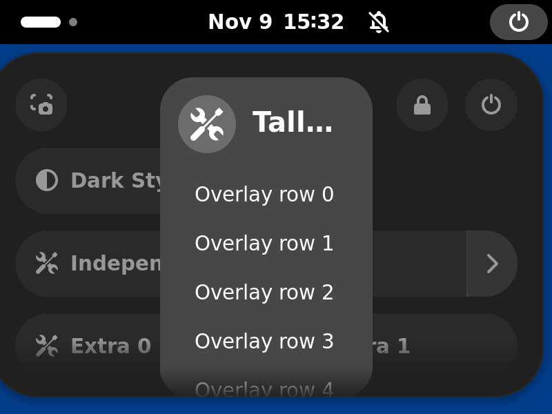
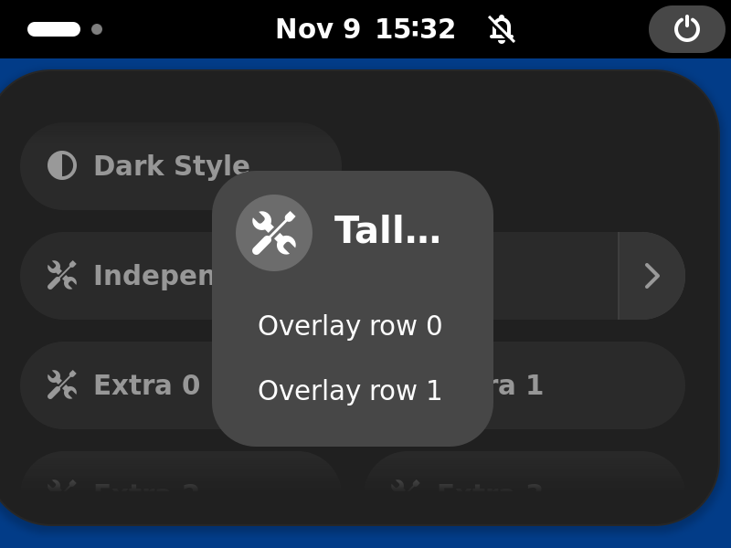

# Compatibility validation

## Implementation boundaries

The upstream grid wrapper remains the ordinary Quick Settings scrolling path. Floating mode is detected from the grid's submenu height-reservation constraint being disabled, which is how Quick Settings Tweaks switches to floating overlays. No UUID-specific settings are read at runtime, and no Shell methods are replaced.

Each floating submenu keeps its original actor, constraints, `box`, menu item API and animation target. Only its box is temporarily parented through a bounded viewport. The viewport reports its capped natural height as its minimum too: both Shell and Tweaks use that minimum to calculate their opening animations. Using an ordinary external-scrollbar view's zero minimum would break those animations.

Height constraints use the source actor's actual monitor work area, theme scale factor and submenu chrome. The floating overlay does not inherit the base menu's scroll translation or clipping. Wheel capture chooses the active submenu view, protects the dimmed background, and yields to sliders and nested views that can scroll in the requested direction. Focus visibility also handles the original inline overlay path.

Corner clipping reads the original box's current theme margins and all four border radii. No colors or corner sizes are hardcoded. The original box remains responsible for its appearance and Tweaks animations. Shell 51's effect API is selected by capability rather than a version string.

Every signal and compositor callback belongs to the patch. Unwrapping restores child order and owned height declarations. Actor destruction drops references without reparenting actors being destroyed. The whole menu can be destroyed while the extension is enabled.

## Native environment and results

Validated on **GNOME Shell 46.0**, using actual Quick Settings Tweaks **2.1-stable**, commit [`5a1def56716f693c7d0055e28a9333263840c9db`](https://github.com/qwreey/quick-settings-tweaks/commit/5a1def56716f693c7d0055e28a9333263840c9db). Tweaks' current development implementation (`7d05bba4b8a65afa4f829149ed1d1a3b255f8c61`) was inspected too, but its declared Shell versions do not include 46, so it was not used as the GNOME 46 fixture.

Tests use real GNOME in disposable Docker sessions with software rendering, private D-Bus, isolated XDG settings/data, and animations forced on. Scaling tests set both the theme scale factor and font DPI, rather than merely enlarging menu padding.

| Configuration | Coverage |
| --- | --- |
| GNOME 46, 100%, 800×600 nested display | Floating and ordinary menus, dynamic content, input, transitions, lifecycle |
| GNOME 46, 200%, 800×600 nested display | Same tests under constrained space, including scaled fonts |
| GNOME 46, 200%, 1280×800 + 1024×768 virtual monitors | Same tests plus relocating the menu source and checking the secondary work area |
| GNOME 51.0, 200%, 1280×800 virtual monitor, Tweaks absent | Ordinary menu wheel input, inline keyboard reachability, height limit and restoration |
| Tweaks alone, 200% | Control reproduction of unbounded overlays and upstream destruction warning |

The fixtures add 20 real Quick Settings toggles and a submenu containing 30 real menu items. Assertions cover:

- Independent overlay and base adjustments, real wheel events, and background scroll isolation.
- Last-control keyboard focus visibility in floating and inline modes.
- Preserving base and overlay positions through close/reopen; shrinking and growing content while open.
- Original menu-item insertion API and actor identities.
- Tweaks overlay mode off, and Quick Settings Scroll without Tweaks.
- Real slider wheel handling without moving the parent menu.
- Both enable orders, both disable orders, disabling with an overlay open, and rapid open/close cycles.
- Dynamically created/destroyed submenu actors, pending callback cleanup, and replacement/destruction of an actual Shell menu instance.

At 200%, Tweaks alone produced an overlay **1,756 px** high in the original geometry-only control. The fully scaled candidate fits the 600-pixel display and exposes the final item through scrolling. Actual dimensions depend on fonts, theme, content and work area; they are not constants in the implementation.





### Known upstream warning

Destroying a submenu while Tweaks 2.1-stable tracks it produces a disposed `St.BoxLayout` warning in **Tweaks' `libs/shared/maid.js`**, followed by a missing-handler warning. Shell destroys the menu's box before emitting the menu's `destroy` signal; Tweaks then tries to disconnect a signal from that destroyed box. This was independently reproduced with **Quick Settings Scroll disabled** using `--qst-only`.

The runner reports this specific upstream stack separately. It fails on other disposed-object stacks, invalid numeric geometry, extension JavaScript errors, or unrelated GObject criticals. The tests also encounter normal stripped-down Docker session service warnings and transient Clutter allocation warnings during animated reparenting. They do not establish that Tweaks itself is warning-free. This fork does not modify Tweaks' cleanup machinery.

## Reproduce

Portable checks need Node.js 22 or later, Python 3 and `zip`:

```sh
make test
make pack
```

The native runner needs `gnome-shell`, `gjs`, `python3`, `dbus-daemon`, `dbus-run-session`, `dconf`/GSettings, `glib-compile-schemas`, `xvfb-run`, `xauth`, and software Mesa. It must run inside a suitable GNOME test image or an isolated test machine. Output directories must be new and outside the repository.

Prepare an independent upstream Tweaks fixture (TypeScript 5.7 and Sass 1.83 were used):

```sh
git clone --branch 2.1-stable https://github.com/qwreey/quick-settings-tweaks.git /tmp/qst-fixture
cd /tmp/qst-fixture
npx --yes --package typescript@5.7.3 tsc --noCheck
mkdir -p target/out
cp -r target/tsc/. target/out/
npx --yes --package sass@1.83.4 sass --no-source-map src/stylesheet.scss target/out/stylesheet.css
cp metadata.json LICENSE target/out/
cp -r schemas media target/out/
glib-compile-schemas --strict target/out/schemas
```

Inside the GNOME 46 test environment, from this repository:

```sh
python3 tests/native/run.py --qst /tmp/qst-fixture/target/out --output /tmp/qs-report-100 --scale 1
python3 tests/native/run.py --qst /tmp/qst-fixture/target/out --output /tmp/qs-report-200 --scale 2
python3 tests/native/run.py --qst /tmp/qst-fixture/target/out --output /tmp/qs-report-multi --scale 2 --multi-monitor
python3 tests/native/run.py --qst /tmp/qst-fixture/target/out --output /tmp/qs-control --scale 2 --qst-only
```

For ordinary-menu testing without loading Tweaks:

```sh
python3 tests/native/run.py --output /tmp/qs-ordinary --scale 2 --ordinary-only --shell-version 46
```

The repository and compiled Tweaks directory can be bind-mounted into the existing GNOME Docker image; run the same commands there and bind-mount an external report directory. Reports include `result.json`, `progress.json`, `shell.log`, and screenshots. CI runs portable checks and packaging; native tests require the separate GNOME environment.

## Scope

GNOME 47–50 and other third-party menus/themes were not exhaustively tested. GNOME 51 validation covered ordinary menus; floating Tweaks overlays were validated on GNOME 46. The upstream 46–51 metadata range is retained. Explicit submenu widths remain controlled by Tweaks; this change constrains height rather than overriding its width preference. There is no new preferences page or support for unrelated Shell popup types.
